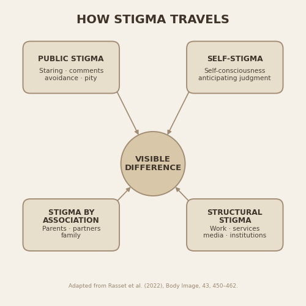

# How Stigma Travels

Python-generated conceptual illustration created for a Semish Kemin essay on visible difference and stigma.

The figure summarizes four forms of stigma discussed in the social stigma framework as applied to facial difference:

- Public stigma
- Self-stigma
- Stigma by association
- Structural stigma

## Figure



The illustration is generated entirely in Python using Matplotlib.

## Source

Rasset P, Mange J, Montalan B, Stutterheim SE. Towards a better understanding of the social stigma of facial difference. *Body Image*. 2022;43:450-462. doi:10.1016/j.bodyim.2022.10.011

The paper applies the social stigma framework of Pryor and Reeder (2011) to facial difference and discusses four forms of stigma: public stigma, self-stigma, stigma by association, and structural stigma.

This repository contains an original visualization of those categories; it does not reproduce a figure from the paper.

## Essay

[Read the essay on Substack](https://semishkemin.substack.com/p/the-weight-of-other-peoples-eyes?r=8veixm&utm_campaign=post&utm_medium=web)

More essays and updates:

[Semish Kemin on Substack](https://substack.com/@semishkemin)

## Run

From the repository environment:

```bash
python how_stigma_travels.py